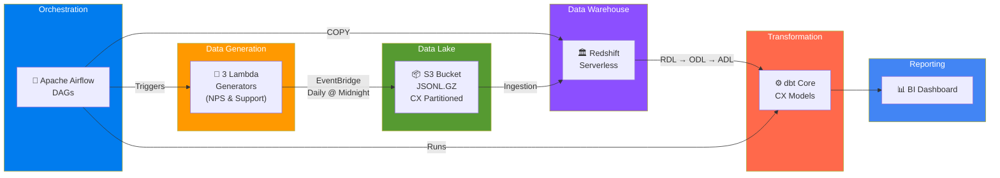
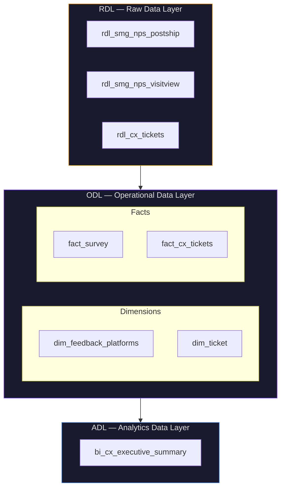
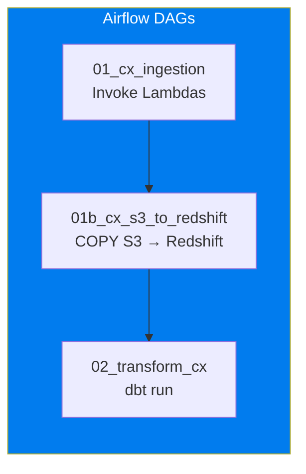

# HnB Project — Customer Experience (CX) Data Pipeline

End-to-end data platform built on AWS, orchestrating simulated Customer Experience (CX) data using Airflow, transformed with dbt, and visualised for executive reporting.

## Architecture Overview

This project simulates a production-grade Customer Experience data pipeline for HnB. It focuses specifically on the "CX" domain: ingesting SMG NPS (Net Promoter Score) surveys (post-purchase and website visits) alongside Customer Support tickets (Zendesk). 

The cloud environment is designed to be managed as Infrastructure as Code using Terraform, orchestrated by Apache Airflow, and follows a three-layer data warehouse pattern (RDL → ODL → ADL).



## Data Warehouse Layers

The warehouse follows the enterprise pattern, specifically modelling the CX domain:



## S3 Data Lake Structure

```
hnb-data-lake/
├── hnb/
│   └── cx/
│       ├── nps_postship/
│       │   └── history/
│       │       └── ingest_date=2026-05-18/
│       │           └── nps_postship.jsonl.gz
│       ├── nps_visitview/
│       │   └── history/...
│       └── customer_support/
│           └── history/...
```

Path pattern: `hnb/cx/{dataset}/history/ingest_date={yyyy-mm-dd}/{dataset}.jsonl.gz`

## CX Analytics & BI
The ADL layer aggregates the NPS and Feedback data into BI-ready models:
- `bi_cx_executive_summary`: High-level aggregate view comparing CSAT (Customer Satisfaction) from support tickets vs NPS scores from web and post-purchase surveys.

## Airflow Orchestration



## Setup & Scaffolding
The repository has been scaffolded to align with this CX architecture, with empty files ready for the development of the Lambda generators, Airflow DAGs, and dbt models.
