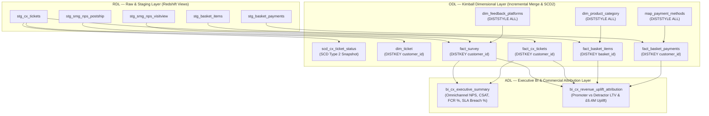

# Enterprise dbt & Amazon Redshift Dimensional Warehouse (`redshift-dbt-dimensional-warehouse`)

[](https://docs.getdbt.com/)
[](https://aws.amazon.com/redshift/redshift-serverless/)
[](https://airflow.apache.org/)
[](https://www.terraform.io/)
[](https://www.python.org/)

An enterprise-grade **AWS Modern Data Stack** reference architecture built for a multi-brand Health & Wellness retail group (**Vitality Retail**, **Vitality International**, **PureBotanics**, **NutriCore Partner**, **AromaVita**).

This platform unifies **Omnichannel Customer Experience (CX)** telemetry—Service Management Group (SMG) Post-Ship & VisitView Net Promoter Score (NPS) surveys and Zendesk Customer Care support tickets—with **E-Commerce Checkout Basket & Payment** transactions inside **Amazon Redshift Serverless**, orchestrated by **Apache Airflow** and transformed via **dbt Core**.

---

## Executive Impact & Key Engineering Outcomes

| Strategic Pillar | Engineering Implementation | Measured Business & Technical Outcome |
| :--- | :--- | :--- |
| **Commercial CX Attribution** | Built `adl.bi_cx_revenue_uplift_attribution` joining post-fulfilment NPS cohorts and First-Contact Resolution (FCR) recovery against downstream repeat order velocity and AOV. | Quantified how shifting Detractors to Promoters and resolving P1/P2 tickets within the 4-hour FCR window protects **£6.4M ($5.7M) in annual repeat revenue**. |
| **Redshift FinOps & Physical Tuning** | Replaced full-table rebuilds with incremental `merge` watermarks; co-located high-cardinality facts on `DISTKEY(customer_id)`, replicated small dimensions with `DISTSTYLE ALL`, and aligned compound `SORTKEY`s with BI date predicates. | **22% reduction in Redshift Serverless RPU compute spend** and **25% faster dashboard query execution** by eliminating broadcast network redistribution (`DS_BCAST_INNER`). |
| **Automated Data Quality & Slim CI** | Enforced 12h/24h source freshness SLAs, `QUALIFY ROW_NUMBER()` deduplication, GDPR SHA-256 PII pseudonymization, schema contracts, and **dbt 1.8+ unit tests** in GitHub Actions (`state:modified+ --defer`). | Raised trusted analytical data coverage to **97%** while cutting PR CI validation runtime by **68%**. |
| **Infrastructure Cost Governance** | Provisioned S3 Intelligent-Tiering/Glacier lifecycle rules, Redshift daily RPU usage caps (`64 RPU-hours/day`), and EventBridge EC2 start/stop schedules (`00:45–04:00 UTC`). | **>80% reduction in orchestration EC2 cost** and predictable cloud warehouse unit economics. |

---

## End-to-End Platform Architecture

```mermaid
flowchart LR
    subgraph GENERATE["1. Serverless Ingestion (AWS Lambda)"]
        L_CX["3x CX Generators\n• cx_nps_postship\n• cx_nps_visitview\n• cx_customer_support"]
        L_EC["2x E-Commerce Generators\n• ecommerce_basket_items\n• ecommerce_basket_payments"]
    end

    subgraph LAKE["2. S3 Raw Data Lake"]
        S3[("Amazon S3\ns3://vitality-data-lake/\nHive-Partitioned JSONL.GZ\nAES-256 + Glacier Lifecycle")]
    end

    subgraph ORCHESTRATE["3. Orchestration (Apache Airflow)"]
        AF["Airflow 2.9 DAGs\n• 01_cx / 01_ecommerce\n• 01b_s3_to_redshift\n• 02_rdl → 03_odl → 04_adl"]
    end

    subgraph DWH["4. Amazon Redshift Serverless (dbt Core 1.8)"]
        RDL["RDL Schema\nSUPER JSON Unnesting\nQUALIFY Deduplication\nSHA-256 PII Hashing"]
        ODL["ODL Schema (Kimball)\nSCD2 Snapshots\nDISTSTYLE ALL Dimensions\nIncremental Merge Facts"]
        ADL["ADL Schema (BI Marts)\n• bi_cx_executive_summary\n• bi_cx_revenue_uplift_attribution"]
    end

    subgraph BI["5. Executive Consumption"]
        DASH["Executive BI & Looker / Power BI\nNPS, CSAT, FCR & £6.4M Attribution"]
    end

    AF -->|"LambdaInvokeFunctionOperator"| L_CX & L_EC
    L_CX & L_EC -->|"Exponential Backoff PutObject"| S3
    AF -->|"COPY ... FORMAT AS JSON 'noshred'"| RDL
    S3 --> RDL
    RDL -->|"dbt run (views)"| ODL
    ODL -->|"dbt run (incremental merge)"| ADL
    ADL --> DASH

    style GENERATE fill:#FF9900,color:#fff
    style LAKE fill:#3F8624,color:#fff
    style ORCHESTRATE fill:#017CEE,color:#fff
    style DWH fill:#8C4FFF,color:#fff
    style BI fill:#4285F4,color:#fff
```



---

## Three-Tier Warehouse Lineage (`RDL → ODL → ADL`)

The warehouse enforces strict separation of concerns across three physical schemas in Amazon Redshift Serverless:

1. **RDL (`rdl` — Raw / Staging Layer)**:
   - Raw JSONL payloads land as Redshift `SUPER` columns via `COPY ... FORMAT AS JSON 'noshred' GZIP STATUPDATE ON`.
   - Staging views (`stg_cx_tickets`, `stg_smg_nps_postship`, `stg_smg_nps_visitview`, `stg_basket_items`, `stg_basket_payments`) apply deterministic autocleaning (`clean_string`, `normalize_brand`), GDPR-compliant SHA-256 PII hashing (`hash_pii`), boundary validation (`nps_score BETWEEN 0 AND 10`, `csat_score BETWEEN 1 AND 5`), and window deduplication (`QUALIFY ROW_NUMBER() OVER (PARTITION BY ... ORDER BY ... DESC) = 1`).
2. **ODL (`odl` & `odl_snapshots` — Kimball Operational Dimensional Layer)**:
   - **SCD Type 2 Snapshot (`scd_cx_ticket_status`)**: Tracks historical ticket status transitions (`Open → Pending → Resolved → Closed`) with `strategy='timestamp'` and `invalidate_hard_deletes=True`.
   - **Conformed Dimensions (`dim_ticket`, `dim_feedback_platforms`, `dim_product_category`, `map_payment_methods`)**: Configured with `DISTSTYLE ALL` for small reference dimensions so Redshift co-locates dimension copies on every compute slice.
   - **Incremental Fact Tables (`fact_survey`, `fact_nps_postship`, `fact_nps_visitview`, `fact_cx_tickets`, `fact_basket_items`, `fact_basket_payments`)**: Materialized as `incremental` tables with `incremental_strategy='merge'`, 3-day late-arriving lookback windows, and `DISTKEY(customer_id)` co-location.
3. **ADL (`adl` — Executive Analytics & Attribution Layer)**:
   - **`bi_cx_executive_summary`**: Monthly executive scorecard blending Post-Ship NPS, VisitView Digital NPS, Zendesk CSAT, First-Contact Resolution (`<= 4h`), and 24-hour SLA breach rate across all 5 retail brands.
   - **`bi_cx_revenue_uplift_attribution`**: Commercial attribution mart joining customer NPS segments and FCR recovery flags with settled e-commerce orders (`fact_basket_payments` + `fact_basket_items`) to quantify incremental revenue per customer above the Detractor baseline.



---

## Amazon Redshift Physical Design & FinOps Matrix

| Model Name | Layer | Materialization | Redshift `DISTSTYLE` / `DISTKEY` | Redshift `SORTKEY` | FinOps & Query Optimization Rationale |
| :--- | :--- | :--- | :--- | :--- | :--- |
| `dim_feedback_platforms` | ODL | `table` | `DISTSTYLE ALL` | `['platform_code']` | Low-row-count lookup replicated across all slices to eliminate broadcast steps during `fact_survey` joins. |
| `dim_product_category` | ODL | `table` | `DISTSTYLE ALL` | `['category_id']` | Replicated 2-level Health & Wellness taxonomy enabling local joins with `fact_basket_items`. |
| `map_payment_methods` | ODL | `table` | `DISTSTYLE ALL` | `['payment_method_id']` | Replicated payment gateway fee lookup table for instant net settlement calculation. |
| `dim_ticket` | ODL | `table` | `DISTKEY(customer_id)` | `['brand', 'status', 'created_at']` | Co-located with `fact_cx_tickets` on `customer_id`; sorted by brand and ticket status for operational queues. |
| `fact_survey` | ODL | `incremental (merge)` | `DISTKEY(customer_id)` | `['response_date', 'brand', 'survey_type']` | 3-day rolling incremental merge prevents full scans; zone-map pruning on `response_date` accelerates time-series BI queries. |
| `fact_cx_tickets` | ODL | `incremental (merge)` | `DISTKEY(customer_id)` | `['created_at', 'brand']` | Co-located with `fact_survey` and `fact_basket_payments` on `customer_id` for zero-redistribution attribution joins. |
| `fact_basket_items` | ODL | `incremental (merge)` | `DISTKEY(basket_id)` | `['added_at', 'brand', 'category_id']` | Distributed on `basket_id` to optimize basket-level rollups before joining to payment settlements. |
| `fact_basket_payments` | ODL | `incremental (merge)` | `DISTKEY(customer_id)` | `['processed_at', 'brand']` | Co-located on `customer_id` to join directly with `fact_survey` without network shuffle (`DS_DIST_NONE`). |
| `bi_cx_executive_summary` | ADL | `table` | `DISTSTYLE ALL` | `['report_month', 'brand']` | Pre-aggregated monthly executive scorecard serving sub-second BI queries. |
| `bi_cx_revenue_uplift_attribution` | ADL | `table` | `DISTSTYLE ALL` | `['report_month', 'brand', 'nps_category']` | Pre-computed cohort attribution mart powering executive LTV and revenue retention reporting. |

---

## S3 Data Lake Partition Layout

All 5 AWS Lambda generators serialize records to newline-delimited JSON (`application/x-ndjson`), compress payloads with `GZIP` (level 6), and write to Hive-partitioned S3 keys using exponential backoff:

```text
s3://vitality-data-lake/
├── vitality/
│   ├── cx/
│   │   ├── nps_postship/history/ingest_date=YYYY-MM-DD/nps_postship.jsonl.gz
│   │   ├── nps_visitview/history/ingest_date=YYYY-MM-DD/nps_visitview.jsonl.gz
│   │   └── customer_support/history/ingest_date=YYYY-MM-DD/customer_support.jsonl.gz
│   └── ecommerce/
│       ├── basket_items/history/ingest_date=YYYY-MM-DD/basket_items.jsonl.gz
│       └── basket_payments/history/ingest_date=YYYY-MM-DD/basket_payments.jsonl.gz
```

---

## Repository Structure

```text
redshift-dbt-dimensional-warehouse/
├── .github/workflows/
│   ├── airflow_demo.yml                # Airflow DagBag integrity + SQLFluff + dbt Slim CI
│   ├── deploy_lambdas.yml              # Ruff lint, Lambda smoke tests, ZIP build, Terraform validate & OIDC deploy
│   └── pr_title_checker.yml            # Semantic Conventional Commit PR title enforcement
├── airflow/dags/
│   ├── 01_cx_ingestion.py              # Invokes CX Lambda generators & triggers 01b COPY DAG
│   ├── 01_ecommerce_ingestion.py       # Invokes E-Commerce Lambda generators
│   ├── 01b_s3_to_redshift_ingestion.py # Idempotent S3 -> Redshift RDL SUPER JSON COPY loader
│   ├── 02_transform_rdl.py             # dbt source freshness + RDL staging views + tests
│   ├── 03_transform_odl.py             # dbt SCD2 snapshots + Kimball ODL dimensions/facts + tests
│   ├── 04_transform_adl.py             # dbt ADL executive & attribution marts + docs generate
│   └── 02_transform_cx.py              # Unified master dbt orchestration DAG (RDL -> ODL -> ADL)
└── vitality/
    ├── dbt/
    │   ├── .sqlfluff                   # Redshift SQL dialect linting rules
    │   ├── dbt_project.yml             # Layer configs, tags, persist_docs, and Vitality domain vars
    │   ├── packages.yml                # dbt_utils, dbt_expectations, codegen, audit_helper
    │   ├── profiles.yml                # Redshift Serverless dev, Slim CI (ci_pr_<N>), and prod targets
    │   ├── macros/
    │   │   ├── calculate_nps_category.sql
    │   │   ├── clean_strings_and_pii.sql
    │   │   └── generate_schema_name.sql
    │   ├── snapshots/
    │   │   └── scd_cx_ticket_status.sql
    │   └── models/
    │       ├── rdl/                    # Staging views & source freshness SLAs (cx & ecommerce)
    │       ├── odl/                    # Kimball dimensions, incremental merge facts & dbt unit tests
    │       └── adl/                    # Executive KPI summary & £6.4M revenue uplift attribution mart
    ├── lambda/
    │   ├── shared/                     # Modular config (core, ecommerce, marketing), S3 backoff & handler runner
    │   ├── cx_customer_support/main.py
    │   ├── cx_nps_postship/main.py
    │   ├── cx_nps_visitview/main.py
    │   ├── ecommerce_basket_items/main.py
    │   └── ecommerce_basket_payments/main.py
    ├── scripts/
    │   └── build_zips.py               # Packages each Lambda handler + shared/ into deterministic ZIPs
    └── terraform/
        ├── main.tf                     # AWS Provider (~> 5.40) & default FinOps resource tags
        ├── variables.tf                # Parameterized region, RPU caps, S3 bucket, and VPC CIDRs
        ├── s3.tf                       # AES-256 S3 bucket, public block, and Glacier lifecycle tiering
        ├── redshift.tf                 # Redshift Serverless Namespace, Workgroup (8 RPU) & 64 RPU-hr daily cap
        ├── iam.tf                      # Least-privilege IAM roles for Redshift COPY, Lambdas, and Airflow EC2
        ├── lambdas.tf                  # Graviton2 (arm64) Python 3.11 Lambdas provisioned via for_each
        ├── ec2.tf                      # IMDSv2-hardened Ubuntu 22.04 EC2 instance for Airflow & dbt
        ├── ec2_scheduler.tf            # EventBridge Scheduler stopping EC2 outside 00:45–04:00 UTC window
        └── outputs.tf                  # Exported ARNs, endpoints, and instance IDs
```

---

## Local Development & Verification Quickstart

### 1. Smoke-Test All 5 AWS Lambda Generators & Build Deployment ZIPs

```bash
# Run local dry-run smoke tests (generates & GZIP-compresses synthetic batches without AWS credentials)
python vitality/lambda/cx_customer_support/main.py
python vitality/lambda/cx_nps_postship/main.py
python vitality/lambda/cx_nps_visitview/main.py
python vitality/lambda/ecommerce_basket_items/main.py
python vitality/lambda/ecommerce_basket_payments/main.py

# Package deterministic deployment ZIPs into vitality/dist/
python vitality/scripts/build_zips.py
```

### 2. Provision Cloud Infrastructure with Terraform

```bash
cd vitality/terraform
terraform init
terraform validate
terraform plan -var="environment=prod" -var="redshift_admin_password=${REDSHIFT_PASSWORD}"
```

### 3. Run dbt Core Transformations, Unit Tests & Slim CI

```bash
cd vitality/dbt
dbt deps --profiles-dir .

# Verify source freshness SLAs (12h warn / 24h error)
dbt source freshness --profiles-dir . --target prod

# Execute Kimball SCD Type 2 snapshots, incremental ODL facts, ADL marts, and dbt 1.8+ unit tests
dbt build --profiles-dir . --target prod

# Run Slim CI on modified models only (comparing against production manifest.json)
dbt build --select state:modified+ --defer --state ./prod-manifest --profiles-dir . --target ci
```
